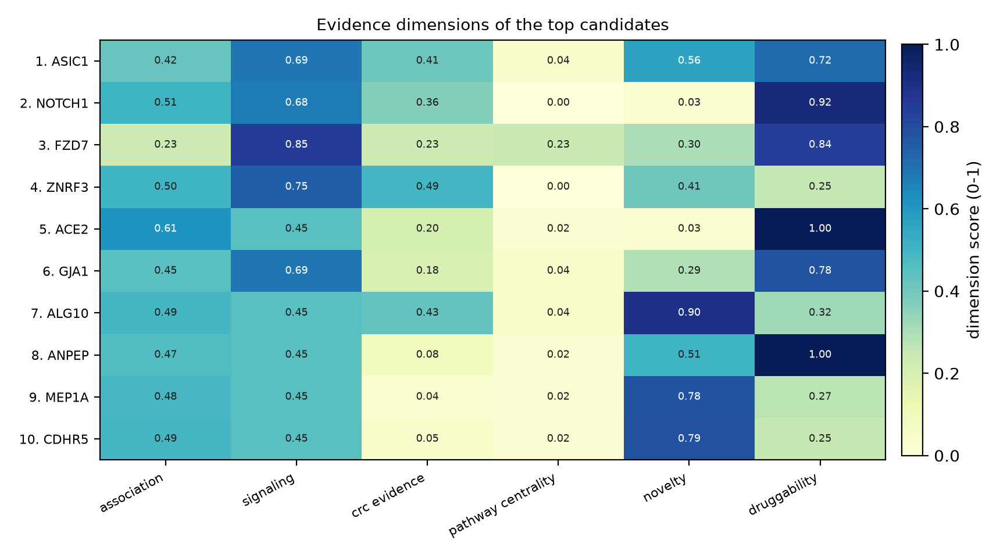
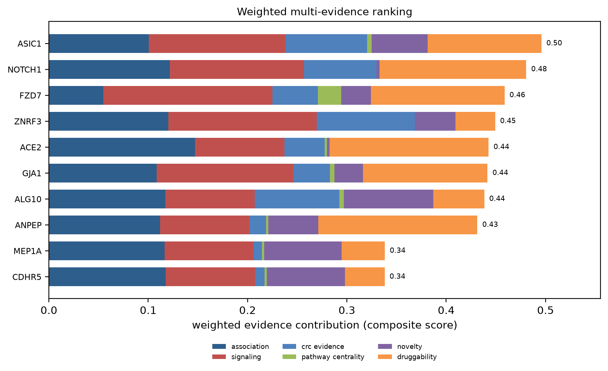
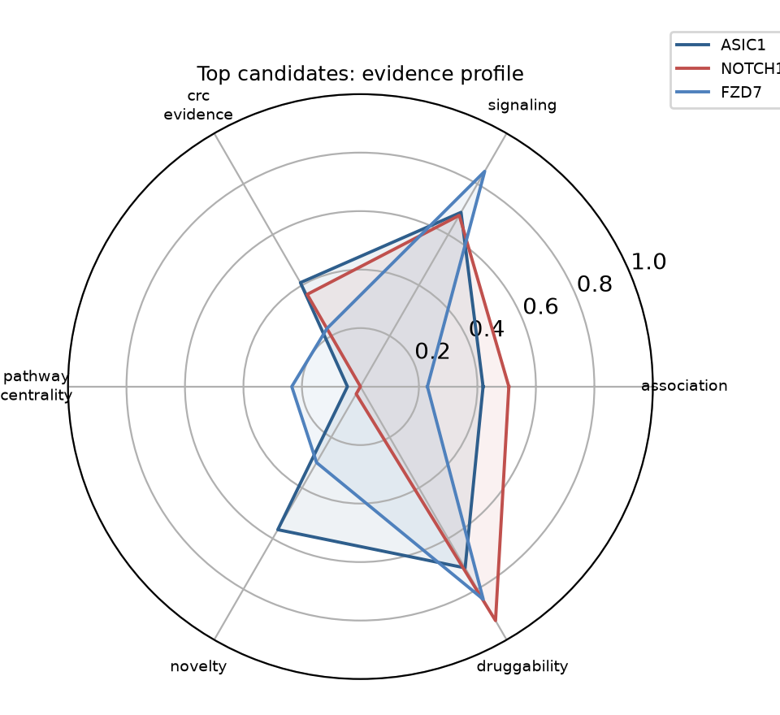
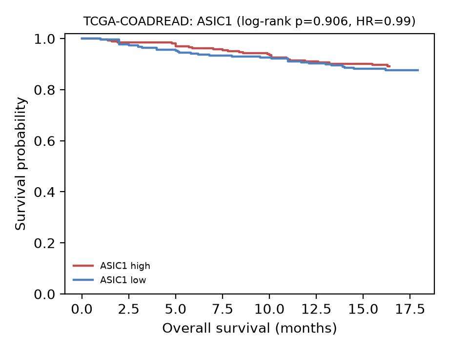

# Multi-agent discovery of a downstream effector target of DPEP1 in colorectal cancer

*Run id*: `20261116_002640_target_discovery_DPEP1`  |  *Engine*: `openai-compatible`  |  *Template*: `downstream_effector_target_discovery`  |  *Date*: 2026-11-16 00:26

> Generated by a MOCHI-style multi-agent system (Manager / Dev / Critic / Tool Creation) operating on real public biomedical databases. Every number below is traceable to a tool call recorded in `provenance.jsonl`.

## 0. 摘要（中文）

**锚点**：DPEP1（UniProt P16444，411 aa）。拓扑判定：GPI-anchored ectoprotein (no transmembrane helix, no intracellular domain)。
因此它**不能自身转导信号**，其效应靶点必须是一个具备胞内信号输出的跨膜蛋白——这是本任务的核心约束。

**排序结论**：在 10 个进入六维打分的候选中，**ASIC1** 排名第一（复合分 0.496，权重 association=0.24, signaling=0.20, crc_evidence=0.20, pathway_centrality=0.10, novelty=0.10, druggability=0.16）；六维中 2 维 ≥0.60（signaling, druggability）。
第二至第四名：NOTCH1(0.481)、FZD7(0.459)、ZNRF3(0.449)。

**可信度**：前五名复合分差仅 0.047，且没有一个候选在 ≥3 个维度上同时达到 0.6，因此这是一个**不确定性下的优先级排序**，不是确证结论；决定性证据来自报告第 8 节的 Co-IP 与回补实验。

## 1. Executive summary

**ASIC1** ranks first among 10 scored candidates (composite score **0.496**), supported by 2 of 6 evidence dimensions (druggability, signaling).

- **Signalling competence**: 0.688 — the candidate can transduce a signal itself, which the anchor protein cannot (GPI-anchored ectoprotein (no transmembrane helix, no intracellular domain)).
- **Association with DPEP1**: PPI 0.43, co-expression r = 0.05, shared Reactome pathways = 0, PubMed co-mentions = 0.
- **Disease evidence**: mean mRNA z vs normal = 1.71; OS log-rank p = 0.906, HR = 0.99.
- **Novelty / druggability**: 0 PubMed papers for the gene in CRC; druggability score 0.72.

## 2. How the answer was produced

**Instruction given to the manager** (default): > Discover the unreported downstream effector target of DPEP1 in the disease: identify the signal-transducing membrane protein through which it acts, ranked by multi-dimensional evidence and supported by a wet-lab validation plan.

| Agent | Responsibility in this run |
|---|---|
| Manager | retrieved the reasoning template, produced the stage plan, calibrated weights, integrated the final report |
| Dev | executed each stage's data pipeline (database glue code + statistics) and persisted artefacts |
| Critic | reviewed tool adequacy and evidence sufficiency, raised capability gaps, re-weighted dimensions |
| Tool Creation | built, validated and registered new tools when a capability gap was found |

### Plan (manager)

1. **Profile construction** — Build a comprehensive functional profile of the anchor gene: sequence and topology (transmembrane segments, GPI anchor, signal peptide), domain architecture, subcellular localisation, pathway membership, disease association, tumour expression, alterations and literature. Explicitly decide whether the anchor can transduce a signal by itself; if it cannot, record the topological constraint the effector must satisfy.

   - tools: query_uniprot, query_opentargets_target, query_opentargets_associations, query_cbioportal_expression, query_cbioportal_alterations, query_pubmed, query_kegg_pathways
   - success criteria: evidence retrieved; critic accepts
2. **Candidate generation** — Generate candidate effectors from four independent sources: physical interaction (STRING + IntAct), expression co-variation in the disease cohort, shared pathway membership, and literature co-mention. Expand the co-expression branch with a signalling-receptor panel so that receptors absent from PPI databases are not missed. Merge into a candidate table.

   - tools: build_ppi_union, query_cbioportal_coexpression, pathway_coannotation, query_pubmed_cooccurrence
   - success criteria: evidence retrieved; critic accepts
3. **Signalling competence scoring** — Score every candidate for its ability to transduce a signal, integrating UniProt topology (transmembrane segments, intracellular domain length), Pfam/InterPro domain families, GO signalling annotations and pathway context. Validate the scorer against known signalling receptors (positive controls) and GPI-anchored / secreted proteins (negative controls) before it is trusted.

   - tools: run_signaling_potential_scorer
   - success criteria: evidence retrieved; critic accepts
4. **Multi-evidence scoring** — Score each candidate on six dimensions: association strength with the anchor, CRC expression/prognosis, pathway centrality, signalling competence, novelty and druggability. Robust-normalise each dimension, then combine with weights calibrated by the critic.

   - tools: multi_evidence_scoring, query_cbioportal_survival, druggability_score, query_pubmed_novelty
   - success criteria: evidence retrieved; critic accepts

*Manager reasoning*: Given a disease-associated anchor gene that cannot transduce a signal itself (for example a GPI-anchored ectoenzyme), discover the membrane receptor through which it acts, by (1) building a functional profile of the anchor, (2) generating candidates from physical interaction, co-expression, shared pathways and literature, (3) scoring every candidate on six orthogonal evidence dimensions (association, signalling competence, disease expression, pathway centrality, novelty, druggability) and (4) integrating the evidence with dynamically calibrated weights into a validated, druggable effector target.

## 3. Stage results

### Profile construction — `ok` (0.0 s)

- DPEP1 = P16444, 411 aa; GPI-anchored ectoprotein (no transmembrane helix, no intracellular domain).
- Open Targets CRC association score = 0.053 (colorectal cancer); 213 associated diseases.
- TCGA-COADREAD: mean mRNA z vs normal = 2.535, 451 tumours with z>2 (n=592).
- Alterations: 5 mutated samples, 0.0 amplified, 0.0068 deep-deleted.
- PubMed hits for DPEP1+disease: 32.

### Candidate generation — `ok` (16.7 s)

- PPI partners of DPEP1: 60 (STRING+IntAct union, score>=0.4).
- Co-expression panel: 600 KEGG signalling genes; 24 correlated with DPEP1 in TCGA-COADREAD (|r|>=0.3, FDR<=0.1).
- Reactome co-annotation: 8 candidates share at least one pathway with DPEP1.
- Literature co-mentions retrieved for 45 candidates (7 with >=1 co-mention).
- Candidate table: 34 expressed candidates retained for scoring.

### Signalling competence scoring — `ok` (0.0 s)

- Scored 34 candidates with score_signaling_potential (0 without UniProt records).
- 10 candidates reach the signalling-competence threshold (0.35).
- Top signalling-competent candidates: FZD7=0.85, ZNRF3=0.748, GJA1=0.688.

### Multi-evidence scoring — `ok` (0.1 s)

- Scored 10 candidates on 6 dimensions with initial weights {"association": 0.24, "signaling": 0.2, "crc_evidence": 0.2, "pathway_centrality": 0.1, "novelty": 0.1, "druggability": 0.16} (the critic may re-calibrate them).
- Coverage: 10 candidates have >=80% of dimensions populated.
- Consistency: 0 candidates are supported by >=3 dimensions.
- Leader: ASIC1 (composite 0.4958, dimensions {'association': 0.4194, 'signaling': 0.688, 'crc_evidence': 0.4104, 'pathway_centrality': 0.0444, 'novelty': 0.565, 'druggability': 0.716}).

## 5. Multi-evidence ranking

Weights: {"association": 0.24, "signaling": 0.2, "crc_evidence": 0.2, "pathway_centrality": 0.1, "novelty": 0.1, "druggability": 0.16}

| rank | gene | composite | association | signalling | CRC evidence | pathway | novelty | druggability | support |
|---|---|---|---|---|---|---|---|---|---|
| 1 | **ASIC1** | 0.496 | 0.42 | 0.69 | 0.41 | 0.04 | 0.56 | 0.72 | 2/6 |
| 2 | **NOTCH1** | 0.481 | 0.51 | 0.68 | 0.36 | 0.00 | 0.03 | 0.92 | 2/6 |
| 3 | **FZD7** | 0.459 | 0.23 | 0.85 | 0.23 | 0.23 | 0.30 | 0.84 | 2/6 |
| 4 | **ZNRF3** | 0.449 | 0.50 | 0.75 | 0.49 | 0.00 | 0.41 | 0.25 | 1/6 |
| 5 | **ACE2** | 0.443 | 0.61 | 0.45 | 0.20 | 0.02 | 0.03 | 1.00 | 2/6 |
| 6 | **GJA1** | 0.442 | 0.45 | 0.69 | 0.18 | 0.04 | 0.29 | 0.78 | 2/6 |
| 7 | **ALG10** | 0.438 | 0.49 | 0.45 | 0.43 | 0.04 | 0.90 | 0.32 | 1/6 |
| 8 | **ANPEP** | 0.431 | 0.47 | 0.45 | 0.08 | 0.02 | 0.51 | 1.00 | 1/6 |
| 9 | **MEP1A** | 0.338 | 0.48 | 0.45 | 0.04 | 0.02 | 0.78 | 0.27 | 1/6 |
| 10 | **CDHR5** | 0.338 | 0.49 | 0.45 | 0.05 | 0.02 | 0.79 | 0.25 | 1/6 |

## 6. Evidence dossier — ASIC1

| evidence type | value | source |
|---|---|---|
| UniProt topology | 2 TM; competence 0.688 (2-pass transmembrane with 117 intracellular residues) | UniProt / created scorer |
| Signalling domain families | ion_channel | Pfam / InterPro |
| PPI with anchor | combined 0.426 (experimental channel 0.426); IntAct interactions 1 | STRING + IntAct |
| Co-expression (TCGA) | r=0.050, FDR=1.000 | cBioPortal COADREAD |
| Shared pathways | 0 (IC 0.0 bits) | Reactome (Enrichr library) |
| Literature co-mention | 0 | PubMed E-utilities |
| Tumour expression | mean z=1.71 | cBioPortal vs normal |
| Prognosis | p=0.906, HR=0.99 | TCGA-COADREAD OS |
| Novelty | 0 CRC papers | PubMed |
| Druggability | 0.72 | ChEMBL + DGIdb + Open Targets |

### Mechanistic hypothesis

DPEP1 is GPI-anchored ectoprotein (no transmembrane helix, no intracellular domain). It cannot generate an intracellular signal on its own, so the phenotype it drives must be relayed by a signal-transducing partner. ASIC1 is the best-supported relay: it has a reported physical interaction with DPEP1 (STRING/IntAct score 0.43); it can itself transduce a signal (competence 0.69; families: ion_channel). The proposed axis is **DPEP1 → ASIC1 → downstream pathway output**. Directionality is not established by correlation, so the axis is stated as a testable hypothesis; the co-IP and epistasis experiments in section 8 are the decisive test.

> The composite score of the top five candidates spans only 0.047, so this is a prioritisation under uncertainty rather than a decisive call. The decisive evidence is the co-IP / epistasis experiment in section 8, not the ranking itself.

## 7. Limitations and contradictions

**Critic audit (deterministic checks):**

- Ranking produced — **PASS**
- Top candidate has >=5 dimensions — **PASS**
- Top candidate is consistent — **FAIL**: the top candidate's evidence dimensions disagree
- Ranking is not a single-dimension artefact — **FAIL**: top candidate supported by 2 dimensions
- Weights sum to 1 — **PASS**

- Correlation-based dimensions (co-expression, literature co-mention) do not establish directionality; the causal claim rests on the topology constraint plus the epistasis experiments proposed below.
- Public bulk cohorts cannot resolve cell-type-specific expression; single-cell or spatial data would strengthen the co-expression argument.
- The scoring transforms are documented heuristics, not a learned model; ranking is sensitive to the critic-calibrated weights, which are reported alongside every score.

## 8. Wet-lab validation handoff

| assay | question | design | readout | priority |
|---|---|---|---|---|
| Co-immunoprecipitation (Co-IP) / proximity ligation | Does DPEP1 physically associate with ASIC1 in CRC cells? | Transfect CRC lines (e.g. HCT116, SW480) with tagged constructs (DPEP1-HA and ASIC1-FLAG, plus tags swapped), immunoprecipitate with anti-HA/anti-FLAG, and probe the reciprocal tag by Western blot. Include a tag-only and a catalytically dead DPEP1 mutant as negative controls. | Co-IP Western blot (reciprocal pull-down), PPI quantification by densitometry | high |
| Loss- and gain-of-function epistasis | Is the phenotype of DPEP1 dependent on ASIC1? | Knock down/out DPEP1 (siRNA or CRISPR) and measure ASIC1 expression and downstream pathway output; then rescue with ASIC1 overexpression or a constitutively active ASIC1 construct. Test whether ASIC1 knockdown abolishes the DPEP1-driven phenotype. | qPCR + Western blot for pathway markers; proliferation/migration/colony assays | high |
| Site-directed mutagenesis of the predicted interface | Which residue(s) of ASIC1 are required for the DPEP1 dependency? | Map the extracellular domain boundaries from the UniProt topology of ASIC1, model the complex (AlphaFold-Multimer / HADDOCK), select 3-5 interface residues, mutate to alanine, and test rescue activity of each mutant. | Rescue assay + Co-IP of each mutant; loss of binding confirms the interface | medium |
| Clinical association in patient cohorts | Do DPEP1 and ASIC1 co-vary and stratify outcome in CRC? | IHC / multiplex immunofluorescence on a CRC TMA for DPEP1 and ASIC1; correlate with stage, MSI status and survival. Cross-check against TCGA-COADREAD expression. | H-score correlation, Kaplan–Meier by co-high vs co-low, Cox model | medium |

## 9. Figures

## 10. Provenance and reproducibility

- Databases: UniProt REST, Open Targets Platform (GraphQL v4), cBioPortal (`coadread_tcga_pan_can_atlas_2018`), PubMed E-utilities, KEGG REST, Reactome/KEGG/GO gene sets via Enrichr, STRING v12, IntAct, QuickGO, InterPro, ChEMBL, DGIdb, mygene.info.
- 190 tool calls recorded in `provenance.jsonl` ({"n_calls": 190, "by_service": {"uniprot": 4, "opentargets": 45, "mygene": 10, "cbioportal": 14, "pubmed": 77, "kegg": 1, "quickgo": 1, "interpro": 1, "string": 2, "intact": 1, "chembl": 24, "dgidb": 10}, "cache_hits": 190}).
- Full agent transcript: `transcript.jsonl`; stage artefacts under the same run directory.
- Re-run: `python cases/dpep1_crc_effector_target.py` (add `--fresh` to ignore the HTTP cache).
