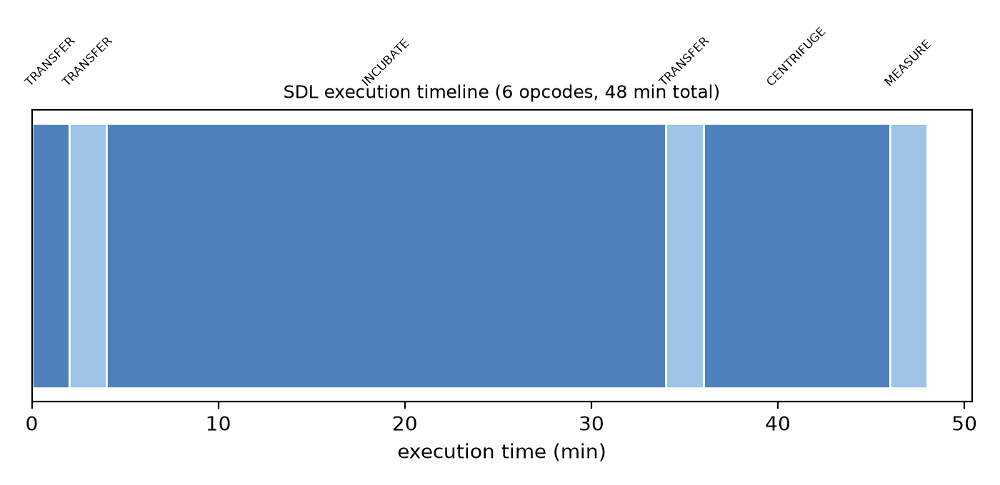

# Compiling wet-lab protocols into validated self-driving-laboratory instructions

*Run*: `20261116_002702_sdl_protocol_str_activity_assay` | *scenario*: `sdl_protocol` | *engine*: `openai-compatible` | *template*: `protocol_to_sdl_compiler` | *date*: 2026-11-16 00:27

**Instruction**: Compile a natural-language wet-lab protocol into a validated, machine-executable self-driving-laboratory instruction program, catch unsafe or infeasible steps, and simulate the execution timeline.

## 1. Summary

- Protocol 'Strictosidine synthase activity assay': 6 executable steps parsed (coverage 1.0).
- Unparsed sentences: 0.
- 6 opcodes emitted: TRANSFER, TRANSFER, INCUBATE, TRANSFER, CENTRIFUGE, MEASURE.
- Estimated duration 48.0 min; 4 compiler warnings.
- 0 issues found (0 errors): none.
- Repair loop: 0 round(s); final validity True.
- no repair needed.
- Simulated timeline: 48.0 min over 6 steps; bottleneck device incubator.
- Compiler benchmark: 6/6 clean protocols validate, 5/5 corrupted protocols caught.

## 2. Method

| Agent | Role in this run |
|---|---|
| Manager | retrieved the scenario template, planned the four stages, calibrated the final ranking |
| Dev | executed each stage's computational pipeline and persisted artefacts |
| Critic | ran the deterministic stage audit and vetoed or accepted each stage |
| Tool Creation | created a new tool if the audit found a capability gap |

### Plan

1. **Protocol ingestion** — Parse the natural-language protocol into typed steps with volumes, temperatures, durations, vessels and reagents.
2. **SDL compilation** — Map each parsed step onto SDL opcodes with normalised SI units and explicit resources.
3. **Validation and repair** — Check volumes against vessel capacity, temperatures against device limits, missing units and ordering constraints; repair what is repairable and report the rest.
4. **Simulation** — Simulate the program on a digital twin of the platform, report the timeline and resource usage, and benchmark the compiler on a protocol suite that includes deliberately corrupted inputs.

*Manager reasoning*: Compile a natural-language wet-lab protocol into a validated, machine-executable self-driving-laboratory (SDL) instruction program. The compiler extracts operations, normalises units, emits typed opcodes, statically validates feasibility and safety (volumes, temperatures, vessel capacity, timing), repairs what it can, and simulates the execution timeline.

## 3. Stage log

| stage | status | attempts | seconds |
|---|---|---|---|
| Protocol ingestion | ok | 1 | 0.0 |
| SDL program synthesis | ok | 1 | 0.0 |
| Static validation and repair | ok | 1 | 0.0 |
| Execution simulation and benchmark | ok | 1 | 0.0 |

## 4. Results

## Results

Protocol: **Strictosidine synthase activity assay** (str_activity_assay): 6 sentences.

### Compiled SDL program

| # | opcode | device | vessel | volume (mL) | T (°C) | duration (min) | source |
|---|---|---|---|---|---|---|---|
| 1 | `TRANSFER` | liquid_handler | vial2ml | 0.05 | — | 2.0 | Add 50 uL of 1 mM tryptamine in phosphate buffer to a 2 mL v |
| 2 | `TRANSFER` | liquid_handler | vial2ml | 0.05 | — | 2.0 | Add 50 uL of 1 mM secologanin. |
| 3 | `INCUBATE` | incubator | vial2ml | — | 30.0 | 30.0 | Incubate at 30 C for 30 min. |
| 4 | `TRANSFER` | liquid_handler | vial2ml | 0.1 | — | 2.0 | Quench with 100 uL of methanol. |
| 5 | `CENTRIFUGE` | centrifuge | vial2ml | — | — | 10.0 | Centrifuge at 12000 g for 10 min. |
| 6 | `MEASURE` | plate_reader | vial2ml | 0.02 | — | 2.0 | Inject 20 uL into the HPLC. |

Validation: **valid**, 0 issues (0 errors).

### Digital-twin execution

Total time **48.0 min**, 6 steps, bottleneck **incubator**, liquid consumed 0.2 mL.

### Compiler benchmark (clean + deliberately corrupted protocols)

| protocol | steps | opcodes | expected error | detected | caught |
|---|---|---|---|---|---|
| str_activity_assay | 6 | 6 | — | — | n/a |
| suzuki_coupling | 7 | 7 | — | — | n/a |
| amide_coupling | 6 | 6 | — | — | n/a |
| reductive_amination | 6 | 6 | — | — | n/a |
| recrystallisation | 5 | 5 | — | — | n/a |
| hplc_sample_prep | 5 | 5 | — | — | n/a |
| overflow_variant | 4 | 4 | vessel_overflow | vessel_overflow | yes |
| overheat_variant | 3 | 3 | temperature_limit | temperature_limit | yes |
| flammable_variant | 3 | 3 | flammable_hazard | flammable_hazard | yes |
| missing_volume_variant | 4 | 4 | missing_volume | missing_volume | yes |
| zero_duration_variant | 3 | 3 | non_positive_duration | non_positive_duration | yes |

## 5. Critic audit

| check | result |
|---|---|
| Benchmark executed | PASS |
| Corrupted protocols detected | PASS |
| Clean protocols accepted | PASS |
| Timeline simulated | PASS |

## 6. Figures

## 7. Limitations

- All numbers are computed by deterministic stage programs; the language model only selects actions and writes prose, so the report is reproducible from the run directory.

## 8. Provenance

- 199 tool calls recorded in `provenance.jsonl` ({"n_calls": 199, "by_service": {"uniprot": 6, "opentargets": 45, "mygene": 10, "cbioportal": 14, "pubmed": 77, "kegg": 1, "quickgo": 1, "interpro": 1, "string": 2, "intact": 1, "chembl": 24, "dgidb": 10, "alphafold": 6, "ena": 1}, "cache_hits": 199}).
- `transcript.jsonl` (agent turns), `llm_calls.jsonl` (model calls), `run_summary.json` (machine summary).
- Re-run: `python cases/run_sdl_protocol.py`
