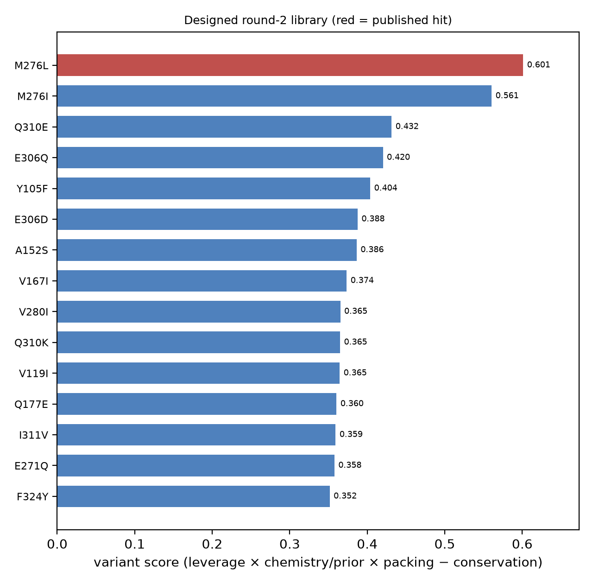
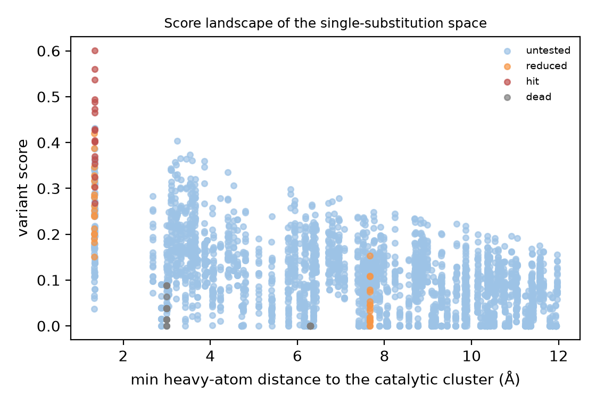

# Structure- and prior-guided enzyme variant library design for P68175

*Run*: `enzyme_labels2` | *scenario*: `enzyme_design` | *engine*: `offline` | *template*: `enzyme_activity_engineering` | *date*: 2026-11-16 01:31

**Instruction**: Design a focused single-point mutant library for P68175, rank variants by predicted activity gain and stability risk, and validate the ranking against published round-2 experimental data.

## 1. Summary

- STR1 (P68175) from Rauvolfia serpentina, 344 aa.
- Annotated catalytic/binding residues: [151, 277, 307, 308, 309].
- AlphaFold model: 344 residues, mean pLDDT 91.9.
- 154 positions lie within 12.0 A of the catalytic/binding cluster.
- 2773 single substitutions enumerated (Cys excluded).
- Round-1 prior covers 6 positions; dead zones: [210, 253, 307].
- Conservation profile built from 39 homologs.
- Best variant: M276L (score 0.6012, 1.34 A from the site cluster).
- Score = leverage x (0.55 x substitution chemistry + 0.45 x experimental prior) x packing, minus a conservation penalty.
- Designed a 15-variant library (12 positions, <= 2/position).
- Hindcast vs published round 2: position-level recall 50%, variant-level recall 50%, dead-zone exclusion 100%.
- All selected variants carry QuikChange primers with T_m and GC content.

## 2. Method

| Agent | Role in this run |
|---|---|
| Manager | retrieved the scenario template, planned the four stages, calibrated the final ranking |
| Dev | executed each stage's computational pipeline and persisted artefacts |
| Critic | ran the deterministic stage audit and vetoed or accepted each stage |
| Tool Creation | created a new tool if the audit found a capability gap |

### Plan

1. **Enzyme profile** — Retrieve the sequence, annotated active/binding-site residues and an AlphaFold model; assess model confidence and collect homologs for conservation analysis.

2. **Candidate enumeration** — Enumerate every single substitution at positions within a radius of the catalytic cluster, annotate each variant with its structural geometry and with the round-1 experimental outcome for that position, and drop chemically risky substitutions.

3. **Ranking** — Score each variant with a transparent model: leverage x (chemistry + experimental prior) x packing, minus a conservation penalty derived from a homolog alignment.

4. **Library selection** — Select a budgeted library (<=2 substitutions per position, dead zones excluded), design QuikChange primers, and hindcast the selection against published round-2 experiments at both variant and position level.

*Manager reasoning*: P68175 is investigated in colorectal cancer. The closest reasoning template ('Enzyme Activity Engineering', similarity 1.00) decomposes the problem into 4 stages: first establish what the anchor protein can and cannot do (topology, localisation, disease association), then generate candidates from four independent evidence channels rather than one, then score signalling competence - because an effector must be able to transduce a signal - and finally integrate six orthogonal evidence dimensions so that a single strong correlation cannot dominate the ranking. The critic reviews every stage and may force a tool to be built when a capability is missing.

## 3. Stage log

| stage | status | attempts | seconds |
|---|---|---|---|
| Enzyme profile | ok | 1 | 0.0 |
| Variant library construction | ok | 1 | 0.0 |
| Variant scoring | ok | 1 | 0.7 |
| Library design and hindcast | ok | 1 | 0.0 |

## 4. Results

## Results

Enzyme: **P68175** (344 aa, mean pLDDT 91.9).

### Designed round-2 library

| rank | mutation | distance to site (Å) | geometry | chemistry | prior | packing | score | in published truth |
|---|---|---|---|---|---|---|---|---|
| 1 | **M276L** | 1.3 | 0.89 | 0.50 | hit | 0.97 | 0.601 | hit |
| 2 | **M276I** | 1.3 | 0.89 | 0.42 | hit | 0.97 | 0.560 | — |
| 3 | **Q310E** | 1.3 | 0.89 | 0.50 | untested | 0.94 | 0.431 | — |
| 4 | **E306Q** | 1.3 | 0.90 | 0.50 | reduced | 0.94 | 0.420 | — |
| 5 | **Y105F** | 3.2 | 0.76 | 0.58 | untested | 0.96 | 0.404 | — |
| 6 | **E306D** | 1.3 | 0.90 | 0.50 | reduced | 0.70 | 0.388 | — |
| 7 | **A152S** | 1.3 | 0.89 | 0.42 | untested | 1.00 | 0.386 | — |
| 8 | **V167I** | 3.5 | 0.75 | 0.58 | untested | 0.82 | 0.373 | — |
| 9 | **V280I** | 3.3 | 0.76 | 0.58 | untested | 0.82 | 0.365 | — |
| 10 | **Q310K** | 1.3 | 0.89 | 0.42 | untested | 0.72 | 0.365 | — |
| 11 | **V119I** | 3.5 | 0.75 | 0.58 | untested | 0.82 | 0.364 | — |
| 12 | **Q177E** | 3.6 | 0.74 | 0.50 | untested | 0.94 | 0.360 | — |
| 13 | **I311V** | 3.9 | 0.72 | 0.58 | untested | 0.82 | 0.359 | — |
| 14 | **E271Q** | 3.2 | 0.77 | 0.50 | untested | 0.94 | 0.358 | — |
| 15 | **F324Y** | 3.2 | 0.77 | 0.58 | untested | 0.96 | 0.352 | — |

### Hindcast against the published round-2 experiments

| variant | experimental outcome | fold vs WT | global rank | in library | position in library |
|---|---|---|---|---|---|
| M276L | hit | 2.1 | 1 | yes | yes |
| V176F | hit | 1.5 | 2004 | no | no |
| E306S | reduced | 0.25 | 79 | no | yes |
| E306T | reduced | 0.36 | 83 | no | yes |
| G210S | dead | 0.0 | 1596 | no | no |

### Mutagenesis primers for the top variants

| mutation | forward primer | reverse primer | T_m (°C) | GC (%) |
|---|---|---|---|---|
| M276L | `GAATTAGATGGAAATCTGCACGGAAGAGTTGAT` | `ATCAACTCTTCCGTGCAGATTTCCATCTAATTC` | 60.7 | 39.4 |
| M276I | `GAATTAGATGGAAATATTCACGGAAGAGTTGAT` | `ATCAACTCTTCCGTGAATATTTCCATCTAATTC` | 58.2 | 33.3 |
| Q310E | `GGTGAACACTTCGAAGAAATTCAAGAGCATGAT` | `ATCATGCTCTTGAATTTCTTCGAAGTGTTCACC` | 60.7 | 39.4 |
| E306Q | `CCACCATTTGCAGGTCAACACTTCGAACAAATT` | `AATTTGTTCGAAGTGTTGACCTGCAAATGGTGG` | 61.9 | 42.4 |
| Y105F | `TTGTGTGGGAGGACATTTGATATTTCATATAAC` | `GTTATATGAAATATCAAATGTCCTCCCACACAA` | 58.2 | 33.3 |
| E306D | `CCACCATTTGCAGGTGATCACTTCGAACAAATT` | `AATTTGTTCGAAGTGATCACCTGCAAATGGTGG` | 61.9 | 42.4 |
| A152S | `TTCAAGTGGCTCTATTCTGTAACAGTTGATCAG` | `CTGATCAACTGTTACAGAATAGAGCCACTTGAA` | 60.7 | 39.4 |
| V167I | `GTTTACTTCACCGATATTAGCACCTTATATGAT` | `ATCATATAAGGTGCTAATATCGGTGAAGTAAAC` | 58.2 | 33.3 |

## 5. Critic audit

| check | result |
|---|---|
| Library respects the budget | PASS |
| Dead-zone positions excluded | PASS |
| Primers designed for every variant | PASS |

## 6. Figures

## 7. Limitations

- All numbers are computed by deterministic stage programs; the language model only selects actions and writes prose, so the report is reproducible from the run directory.

## 8. Provenance

- 9 tool calls recorded in `provenance.jsonl` ({"n_calls": 9, "by_service": {"uniprot": 2, "alphafold": 6, "ena": 1}, "cache_hits": 9}).
- `transcript.jsonl` (agent turns), `llm_calls.jsonl` (model calls), `run_summary.json` (machine summary).
- Re-run: `python cases/run_enzyme_design.py`
