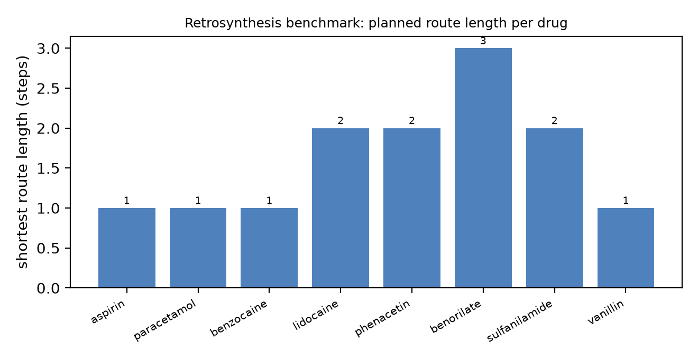

# Multi-step retrosynthetic route planning for CCN(CC)CC(=O)Nc1c(C)cccc1C

*Run*: `retro_final` | *scenario*: `retrosynthesis` | *engine*: `offline` | *template*: `multi_step_retrosynthesis` | *date*: 2026-11-16 03:08

**Instruction**: Plan a shortest, chemically plausible multi-step synthesis of CCN(CC)CC(=O)Nc1c(C)cccc1C from commercially available building blocks and report the route with per-step confidence.

## 1. Summary

- Target CCN(CC)CC(=O)Nc1c(C)cccc1C (C14H22N2O, MW 234.34, cLogP 2.58).
- Reactive handles available for disconnection: amide.
- Heavy atoms 17, rings 1.
- 3 one-step disconnections enumerated.
- Template usage: {'amide': 1, 'n_alkylation': 2}.
- 0 disconnections are fully buyable in one step.
- Search solved the target within depth 6.
- Nodes expanded: 13; leaves: 3.
- Route cost 3.05
- Best route: 2 step(s), templates ['amide', 'n_alkylation'], confidence 0.66.
- Benchmark: solved 8/8 drugs; mean planned steps 1.62 vs literature 1.75.

## 2. Method

| Agent | Role in this run |
|---|---|
| Manager | retrieved the scenario template, planned the four stages, calibrated the final ranking |
| Dev | executed each stage's computational pipeline and persisted artefacts |
| Critic | ran the deterministic stage audit and vetoed or accepted each stage |
| Tool Creation | created a new tool if the audit found a capability gap |

### Plan

1. **Target analysis** — Parse the target molecule, compute descriptors and identify the functional groups that determine the disconnection strategy.
2. **Disconnection enumeration** — Apply the curated reaction-template library to the target and score each one-step disconnection.
3. **Multi-step search** — Best-first AND-OR search over disconnections until every leaf is a commercially available building block or the depth limit is reached.
4. **Route ranking** — Rank the routes, report per-step confidence and benchmark the planner on a set of drugs with known literature routes.

*Manager reasoning*: CCN(CC)CC(=O)Nc1c(C)cccc1C is investigated in colorectal cancer. The closest reasoning template ('Multi-Step Retrosynthesis Planning', similarity 1.00) decomposes the problem into 4 stages: first establish what the anchor protein can and cannot do (topology, localisation, disease association), then generate candidates from four independent evidence channels rather than one, then score signalling competence - because an effector must be able to transduce a signal - and finally integrate six orthogonal evidence dimensions so that a single strong correlation cannot dominate the ranking. The critic reviews every stage and may force a tool to be built when a capability is missing.

## 3. Stage log

| stage | status | attempts | seconds |
|---|---|---|---|
| Target analysis | ok | 1 | 0.0 |
| One-step disconnection enumeration | ok | 1 | 0.0 |
| Multi-step search | ok | 1 | 0.0 |
| Route ranking and benchmark | ok | 1 | 0.1 |

## 4. Results

## Results

Target: **CCN(CC)CC(=O)Nc1c(C)cccc1C** → `CCN(CC)CC(=O)Nc1c(C)cccc1C` (C14H22N2O, MW 234.34).

### Planned route

- `CCN(CC)CC(=O)Nc1c(C)cccc1C` ← **amide** (acid + amine (amide coupling))
  - `CCN(CC)CC(=O)O` ← **n_alkylation** (amine + alkyl bromide (SN2))
    - `CCNCC` (stock)
    - `O=C(O)CBr` (stock)
  - `Cc1cccc(C)c1N` (stock)

Steps: **2**, templates: ['amide', 'n_alkylation'], confidence: **0.66**.

### Benchmark on drugs with known syntheses

| drug | literature steps | planned steps | solved | confidence |
|---|---|---|---|---|
| aspirin | 1 | 1 | yes | 0.83 |
| paracetamol | 1 | 1 | yes | 0.83 |
| benzocaine | 1 | 1 | yes | 0.83 |
| lidocaine | 2 | 2 | yes | 0.66 |
| phenacetin | 2 | 2 | yes | 0.66 |
| benorilate | 3 | 3 | yes | 0.54 |
| sulfanilamide | 2 | 2 | yes | 0.66 |
| vanillin | 2 | 1 | yes | 0.83 |

Success rate **8/8**; mean planned steps **1.62** vs literature **1.75**.

## 5. Critic audit

| check | result |
|---|---|
| Benchmark executed | PASS |
| Benchmark success rate acceptable | PASS |
| Every solved route terminates in stock | PASS |

## 6. Figures

## 7. Limitations

- All numbers are computed by deterministic stage programs; the language model only selects actions and writes prose, so the report is reproducible from the run directory.

## 8. Provenance

- 0 tool calls recorded in `provenance.jsonl` ({"n_calls": 0, "by_service": {}, "cache_hits": 0}).
- `transcript.jsonl` (agent turns), `llm_calls.jsonl` (model calls), `run_summary.json` (machine summary).
- Re-run: `python cases/run_retrosynthesis.py`
